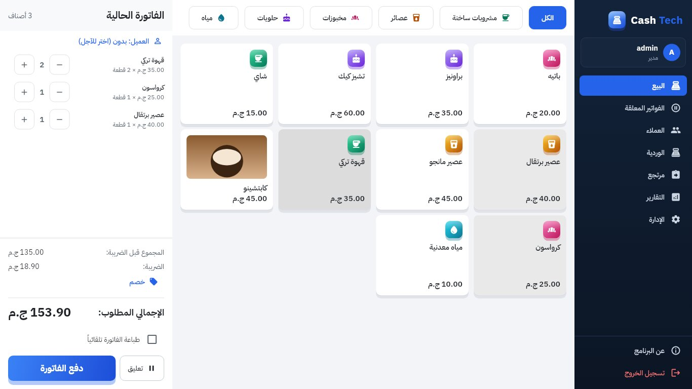
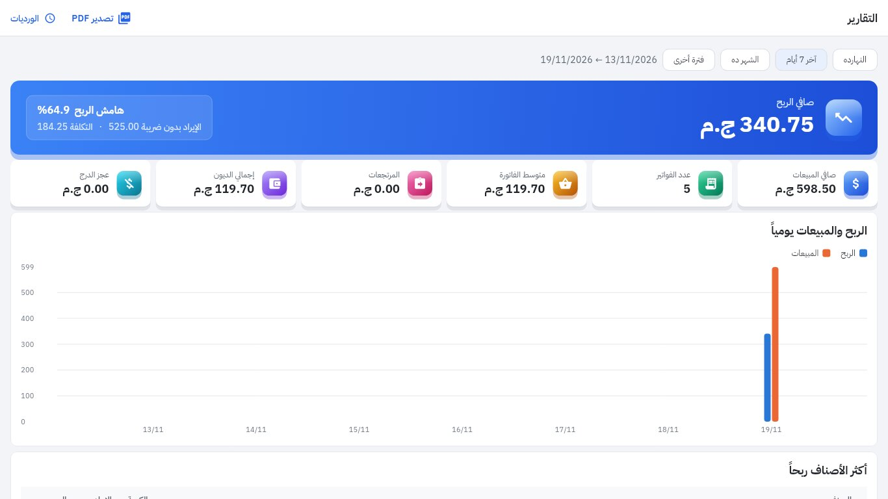

<h1 align="center">Cash Tech</h1>

<b>نظام نقاط بيع متكامل لكل أنواع المحلات</b> 
بيع أسرع، وحسابات مضبوطة بالقرش، ومعرفة حقيقية بمكسبك — حتى من غير نت.

## ⬇️ التحميل (آخر إصدار)

| النظام | الملف |
|---|---|
| **ويندوز 10 / 11 (64 بت)** | [Cash-Tech-Setup.exe](https://github.com/lord7oda/cash-tech-downloads/releases/latest/download/Cash-Tech-Setup.exe) |
| **Ubuntu / Linux Mint / Debian / Zorin** | [cash-tech_amd64.deb](https://github.com/lord7oda/cash-tech-downloads/releases/latest/download/cash-tech_amd64.deb) |
| **أي توزيعة لينكس** (بيتسطّب لوحده أول تشغيل) | [Cash-Tech-Linux.zip](https://github.com/lord7oda/cash-tech-downloads/releases/latest/download/Cash-Tech-Linux.zip) |
| أي توزيعة لينكس (للمتقدمين: `install.sh`) | [cash-tech-linux-x64.tar.gz](https://github.com/lord7oda/cash-tech-downloads/releases/latest/download/cash-tech-linux-x64.tar.gz) |

كل الإصدارات: [صفحة الإصدارات](https://github.com/lord7oda/cash-tech-downloads/releases)

> البرنامج محتاج **مفتاح ترخيص** للتفعيل. للحصول على مفتاح أو عرض تجريبي تواصل معانا (تحت).

## التثبيت

**ويندوز:** شغّل `Cash-Tech-Setup.exe` وكمّل الخطوات. لو ظهرت رسالة «Windows protected your PC» دوس **More info** ← **Run anyway**.

**Ubuntu / Mint:** دبل كليك على ملف `.deb` ← **Install**.

**أي توزيعة تانية:** فك ضغط `Cash-Tech-Linux.zip` ودوس على `Cash-Tech-…AppImage`. أول تشغيل بيسطّبه في قائمة البرامج لوحده.

التحديث: نفس الخطوات بالإصدار الجديد — **بيانات المحل بتفضل زي ما هي**.

## المميزات

- بيع سريع بالباركود وباركود الميزان، و5 أنواع أصناف (قطعة، وزن، مقاسات وألوان، وجبات بوصفة، خدمات).
- دفع نقدي وبطاقة ومحفظة وآجل، وتقسيم الفاتورة، وخصومات بصلاحيات.
- مخزون ومشتريات وموردين وسداد المتبقي لهم، ومتوسط تكلفة، وجرد وهالك.
- ورديات ودرج الكاش: المتوقع والعجز والزيادة لكل موظف.
- عملاء وآجل وحد ائتمان وكشف حساب، ومرتجع واستبدال.
- تقارير الربح الحقيقي، وتصدير PDF.
- نسخ احتياطي تلقائي متشفّر على Google Drive، واسترجاع كامل على جهاز جديد.
- عربي وإنجليزي وفرنساوي وإسباني، وأي عملة، والضريبة بتتشغّل أو تتقفل.
- بيشتغل من غير نت.

## التواصل

**Tech Trip · رحلة تقنية** — هاتف / واتساب: +20 1127532619 — [tech-trip-ar.blogspot.com](https://tech-trip-ar.blogspot.com)

[سياسة الخصوصية](https://tech-trip-ar.blogspot.com/p/cash-tech-privacy.html)

